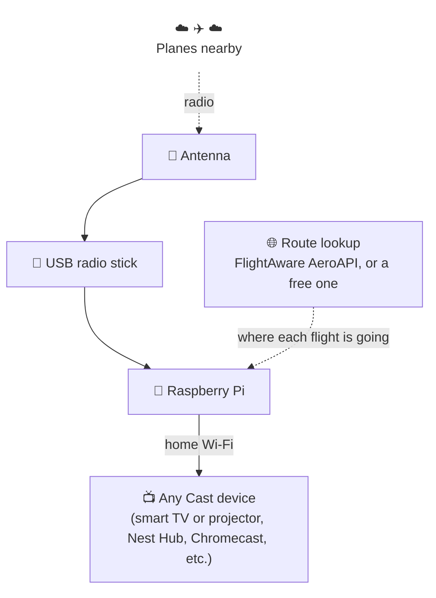

# Sky Above ✈️

Hear a plane, look up, wonder where it's going? Sky Above tells you. When a plane flies near home,
your TV or smart display shows who it is and where it's headed, and reads it out loud. 🛬


| | |
|---|---|
|  |  |
| 🚁 Air ambulances and police get their own look | 🪖 So do military aircraft |
|  |  |
| 🧳 A flight you're following, before it leaves... | ...and on its way |

*All made-up flights, with Greenwich standing in for home.*

## What you get

- 📺 A big, easy to read card: airline, flight, from, to, height, speed
- 🗣️ A voice that announces each plane ("from Alicante, to London Stansted, 1 kilometre away")
- ⏱️ A heads-up for planes on their way ("overhead in about 4 minutes"), timed for when you actually hear it, or "overhead now" if it'll be right above you by then
- 🧳 Flights you care about, yours or friends' and family's, followed from four hours before take-off until landing
- 🚁 Air ambulance and police helicopters in their own colours, where your country gives them their own callsigns
- 🪖 Military aircraft in olive, named by who flies them ("Royal Air Force, Airbus A400M Atlas")
- 🚨 Planes in an emergency, anywhere your antenna can hear them: squawking 7700, 7600 or 7500, or
  diving or climbing far faster than any normal flight. They go red, take the screen until it's
  over, and get read out a bit louder
- 🗺️ A live map of every plane nearby
- 🏠 Your location never leaves the house

## How it works



1. Every airliner broadcasts where it is, several times a second.
2. The antenna and stick pick that up.
3. The Pi finds the closest plane and looks up where it's going.
4. It sends a card to your screen, like casting a video from your phone.

## What you need 🛒

| Thing | Roughly |
|---|---|
| Raspberry Pi 4 (or any newer Pi) and a microSD card, 32 GB or larger | £60 |
| FlightAware Pro Stick Plus (the USB radio) | £60 |
| A 1090 MHz antenna | £8 |
| Any Cast device on your Wi-Fi (smart TV or projector, Nest Hub, Chromecast, etc.) | you probably have one already |
| A Google Cast developer account, a one-off fee | $5 |
| A FlightAware AeroAPI key, for routes (optional but worth it) | free |

You'll also need a computer to set up the Pi from. You'll copy and paste a few commands, but you
don't need to know what they mean.

## Setting up 🍓

Set aside an hour. Most of it is waiting.

### Step 1: Get the Pi going

1. Install **Raspberry Pi Imager** on your computer. On a Mac with [Homebrew](https://brew.sh):

   ```bash
   brew install --cask raspberry-pi-imager
   ```

   No Homebrew? Either install it first (the one line on [brew.sh](https://brew.sh)), or download
   Imager straight from [raspberrypi.com/software](https://www.raspberrypi.com/software/), which
   also has it for Windows and Linux.
2. Put the microSD card in your computer, open Imager, and choose:
   - **Device:** your Pi
   - **Operating system:** Raspberry Pi OS (other), then **Raspberry Pi OS Lite (64-bit)**
   - **Storage:** the card
3. When it asks about customising, fill in:
   - a name for the Pi (say `skyabove`)
   - a username and password
   - your Wi-Fi
   - turn on SSH
4. Put the card in the Pi, plug the stick into a **black** USB port, attach the antenna, power it up.
5. On your computer, open Terminal and connect to the Pi (use your username):

   ```bash
   ssh you@skyabove.local
   ```

6. Update everything on the Pi:

   ```bash
   sudo apt update && sudo apt full-upgrade -y
   ```

7. Stop the Pi grabbing the stick. Inside, the stick uses the same chip as a USB TV tuner (with a
   filter and amplifier for planes added), so the Pi thinks it's for watching TV and won't let
   anything else have it. This writes a small file telling it to leave the stick alone, so Sky Above
   can use it as a radio instead. FlightAware's own PiAware image does this for you, plain Raspberry
   Pi OS doesn't:

   ```bash
   printf "blacklist dvb_usb_rtl28xxu\nblacklist rtl2832_sdr\nblacklist rtl2832\nblacklist rtl2830\nblacklist dvb_usb_v2\n" | sudo tee /etc/modprobe.d/blacklist-rtl-sdr.conf
   ```

8. Install Docker, which runs all the parts of Sky Above, and restart:

   ```bash
   sudo apt install -y docker.io docker-compose git && sudo usermod -aG docker "$USER" && sudo reboot
   ```

### Step 2: Install Sky Above

1. Connect again once it's restarted (`ssh you@skyabove.local`), then:

   ```bash
   git clone https://github.com/christianjbrown/sky-above.git ~/sky-above && cd ~/sky-above && cp .env.example .env
   ```

2. Open the settings file:

   ```bash
   nano .env
   ```

3. Fill in:
   - `FEEDER_LAT` and `FEEDER_LONG`: where the antenna is (right-click your house in Google Maps to
     copy them)
   - `FEEDER_ALT`: how high the antenna is above sea level, in metres or feet: `30m` or `100ft`.
     Search the web for your address's elevation, then add how far up the antenna is. Close enough
     is fine.
   - `FEEDER_TZ`: your time zone, like `Europe/London`, `America/New_York` or `Australia/Sydney`
   - `HOME_COUNTRY`: your country's two-letter code, like `GB`, `US` or `DE`, so places at home get
     no flag
   - `CAST_DEVICE_NAME`: your screen's name, exactly as the Google Home app shows it
4. Save with Ctrl+O, Enter, then Ctrl+X. Start it:

   ```bash
   docker compose up -d
   ```

5. On your computer, open `http://skyabove.local:8080`. Planes should start appearing. 🎉

### Step 3: Connect your screen

Google needs to know about your screen before the Pi can show anything on it.

1. Sign in at https://cast.google.com/publish and pay the $5.
2. Click **Add new application**, then **Custom Receiver**.
   - Name: Sky Above
   - Receiver URL: `http://` then your Pi's address, then `:8090/` (for example
     `http://192.168.1.50:8090/`). Your router's app lists the address.
   - Don't publish it. Copy the **Application ID**.
3. Click **Add new device** and enter your screen's serial number (Google Home app, the screen's
   settings, Device information).
4. In the Google Home app, in the screen's settings, turn on **Send device usage data and crash
   reports**.
5. Wait about 15 minutes, then restart the screen.
6. Back on the Pi, `nano .env`, put the ID after `CAST_APP_ID=`, save, and run
   `docker compose up -d`.
7. In your router's app, give the Pi a fixed address, so it never changes.

Now wait for a plane. ✨

### Step 4: Better routes (optional)

Without a key, routes come from a free service that's often out of date.

1. Get a personal key at https://www.flightaware.com/aeroapi/portal/
2. Put it after `AEROAPI_KEY=` in `.env`, save, and run `docker compose up -d`.

## Following a flight 🧳

Picking someone up, or off on holiday yourself?

1. On the Pi, `mkdir -p ~/sky-above/followed && nano ~/sky-above/followed/flights.txt`
2. Add a line with the date it leaves and the flight number. The date is the one on the ticket:
   the local date where it leaves from, whatever time zone you're in.

   ```text
   2027-03-12 BA4321
   ```

3. Save. That's it, no restart needed.

On the day, when no plane is overhead, the screen shows:

- **Before take-off:** a countdown, the gate, and any delay, in red
- **In the air:** time to landing and the plane moving on a world map
- **After landing:** the baggage belt 🛄

Airlines often say "on time" until the last minute. Sky Above also checks where the plane is coming
from, and if it can't make it back in time it says "Likely delayed 25 min" and why. 🕵️

It also speaks up when something changes 🔔:

- a gate is given out, or changes
- the delay moves by 10 minutes or more, or it's back on time
- it's cancelled or diverted
- it takes off, with when it should land
- it's about 20 minutes from landing
- it lands
- the baggage belt is given out, or changes

Each followed flight costs roughly 50 cents to $2 in AeroAPI lookups.

## Good to know

- 🤫 **Quiet hours.** Nothing on the screen from midnight to 8am, except helicopters and military
  aircraft, which are rare enough to be worth waking up for. Don't want those either? Set
  `QUIET_HOURS_EXCEPT=` (empty) in `.env`.
- 🚨 **Emergencies win.** A plane in an emergency beats everything, quiet hours included, and stays
  up until it has been over for a minute. Air ambulances, police and military aircraft that come
  into the zone keep the card until they're 5 km away, so a plane passing through waits its turn.
  On a Nest Hub the emergency announcement turns the volume up to 8 out of 10 (never down) and puts
  it back afterwards.
- 🎵 **Polite.** It only casts when the screen is idle, so it won't interrupt music, a film or a
  timer.
- 🧪 **Try it without a plane.** Open `http://skyabove.local:8090/?demo` for a made-up one. Also
  `?demo=followed`, `?demo=taxiing`, `?demo=flying`, `?demo=landed`, `?demo=ambulance`, `?demo=police`, `?demo=military` and `?demo=emergency`.
- 🏠 **Privacy.** Your location stays in `.env` on the Pi. The Pi does ask FlightAware about planes
  passing near you, which hints at roughly where you are. Leave `AEROAPI_KEY` empty and set
  `ROUTE_API_URL=` to stop that.

## Handy commands 🧰

Run these on the Pi, from `~/sky-above`:

| To | Run |
|---|---|
| See what's running | `docker compose ps` |
| Watch what it's doing | `docker compose logs -f watcher` |
| Update Sky Above | `git pull && docker compose up -d --build` |
| Update everything else | `docker compose pull && docker compose up -d` |
| Check the power supply | `vcgencmd get_throttled` (0x0 is good) |

## Settings ⚙️

All in `.env`. After changing one, run `docker compose up -d` so it takes effect. The ones you're
most likely to change:

| Setting | What it does | What to put | Default |
|---|---|---|---|
| `ZONE_RADIUS_KM` | How close a plane has to be | kilometres, like `1.5` | `2` |
| `QUIET_HOURS` | When it won't cast at all | start and end, like `00:00-08:00`, or empty for never | `00:00-08:00` |
| `SPEECH_QUIET_HOURS` | When it won't speak | the same as above | `00:00-08:00` |
| `QUIET_HOURS_EXCEPT` | What still gets through both kinds of quiet hours | `helicopters`, `military`, both, or empty for nothing | `helicopters,military` |
| `SPEECH_SERVER` | Where the voice comes from | empty for no voice at all | the Pi's own |
| `PIPER_VOICE` | Which voice it speaks in | any voice name from the list below | `en_GB-southern_english_female-low` |
| `FOLLOWED_MONTHLY_LIMIT` | Cap on followed-flight lookups a month | a number | `600` |
| `LINGER_SECONDS` | How long the card stays after the plane leaves | seconds | `30` |
| `CARD_MIN_SECONDS` | The shortest time a plane's card is up | seconds | `60` |
| `AIR_AMBULANCE_CALLSIGNS` | Which planes get the air ambulance look | the code their callsigns start with, like `HLE` in the UK | empty |
| `POLICE_CALLSIGNS` | Which planes get the police look | the same, like `UKP` in the UK | empty |

🗣️ **Picking a voice.** Have a listen on [Piper's samples page](https://rhasspy.github.io/piper-samples/),
pick one, and use its name, which is the language, the voice and the quality joined by hyphens. A
few to try:

- `en_GB-alan-medium`, a British man
- `en_GB-jenny_dioco-medium`, a British woman
- `en_GB-northern_english_male-medium`, a man from the north of England
- `en_US-lessac-medium`, an American woman

`low` voices sound a bit rougher but are quicker to make, `medium` ones are clearer. The Pi
downloads a new voice the first time it's used.

`.env.example` lists the rest, with a note on each.

## For the curious 🔍

<details>
<summary>Sharing with FlightAware and Flightradar24 (free premium accounts)</summary>

Optional and separate from Sky Above. Two extra containers pass on what your stick hears, and in
return you get a free FlightAware Enterprise account and Flightradar24's Contributor plan.

**FlightAware.** Get a feeder ID:

```bash
timeout 60 docker run --rm ghcr.io/sdr-enthusiasts/docker-piaware:latest | grep "my feeder ID"
```

Put it in `.env` as `PIAWARE_FEEDER_ID`, add `flightaware` to `COMPOSE_PROFILES`, run
`docker compose up -d`, then claim the receiver at https://flightaware.com/adsb/piaware/claim.

**Flightradar24.** Get a sharing key:

```bash
docker run -it --rm --entrypoint /usr/bin/fr24feed ghcr.io/sdr-enthusiasts/docker-flightradar24:latest --signup --configfile=/tmp/config.txt
```

Say no to MLAT and pick receiver type 4. Put the key in `.env` as `FR24KEY`, add `flightradar24` to
`COMPOSE_PROFILES` (`flightaware,flightradar24` for both) and run `docker compose up -d`.

Both need your exact position for MLAT. Both let you hide it from your public stats page.

</details>

<details>
<summary>What's running on the Pi</summary>

| Service | What it does |
|---|---|
| `ultrafeeder` | Decodes the radio, draws the map at `:8080` |
| `watcher` | Picks the plane and casts the card (the Python in this repo) |
| `receiver` | Serves the card page at `:8090` |
| `piper` | Turns announcements into speech, on the Pi |
| `piaware`, `flightradar24` | The optional feeders |

</details>

<details>
<summary>How it picks a plane</summary>

- A plane inside the zone always gets a card.
- A plane further out has to hold a steady course pointing through the zone, for five seconds plus
  two for every km away. That rules out anything beyond about 38 km.
- Planes coming down low more than 10 km out (air traffic control is steering them in to land, so
  their line means nothing) and planes that will land before they reach you don't count. Planes
  climbing out after take-off do, even though their departure route sometimes turns them away
  at the last moment, because they're low and heard late.
- Planes that come overhead teach it the paths they flew to get there. Once two of them have
  come along the same path, the next plane at the same spot, height and heading gets its card
  straight away, even mid-turn onto a departure route, where its straight line points somewhere
  else for a while. Each runway's route is learned separately, and the paths are kept in
  `paths.json` in the watcher's state, so a restart doesn't forget them.
- The card stays 30 seconds after the plane leaves (`LINGER_SECONDS`), and at least a minute in all
  (`CARD_MIN_SECONDS`).
- Places in your own country (`HOME_COUNTRY`) have no flag. Leave it empty and it goes by the
  airport nearest home, which is fine unless you live near a border.
- A plane on its way waits for the card on screen to finish its time before it's shown and
  announced. A plane that comes into the zone takes over straight away.

</details>

<details>
<summary>How it guesses delays</summary>

It follows the plane's earlier flights that day. Each one gets its typical gate-to-gate time over
the last week, then a turnaround of 25, 35 or 75 minutes depending on the plane's size. If that
lands later than the airline's time, the card goes with ours.

</details>

<details>
<summary>Maps</summary>

The maps come from [Protomaps](https://protomaps.com) and live on the Pi, so the screen never asks
a map server anything. They're too big for git, so cut them into `map/` with the
[pmtiles](https://github.com/protomaps/go-pmtiles) tool, using a build date from
https://maps.protomaps.com/builds:

```bash
pmtiles extract https://build.protomaps.com/20261101.pmtiles map/area.pmtiles --bbox=-0.85,51.15,0.85,51.8 --maxzoom=14
pmtiles extract https://build.protomaps.com/20261101.pmtiles map/world.pmtiles --maxzoom=6
```

The `--bbox` is the area round home, as west, south, east, north. That one is about 60 km each way
round Greenwich: take your own longitude and latitude and go about 0.85 either side of the
longitude and 0.33 either side of the latitude. No maps? The card just goes without.

Place names not in the Latin alphabet need their fonts too: see `tools/fetch_map_assets.py`.

</details>

<details>
<summary>Airports, flags and logos</summary>

- Airports come from [OurAirports](https://ourairports.com/data/) (public domain). Refresh with
  `python3 tools/fetch_airports.py`.
- Logos come from [Soaring Symbols](https://github.com/anhthang/soaring-symbols) (MIT), plus a few
  public-domain and CC0 ones from Wikimedia. Refresh with `python3 tools/fetch_airline_logos.py`.
- The map's scripts and fonts are fetched by `python3 tools/fetch_map_assets.py`.
- The map runs on [MapLibre GL JS](https://maplibre.org) and [PMTiles](https://github.com/protomaps/PMTiles)
  (both BSD-3-Clause), styled with [Protomaps basemaps](https://github.com/protomaps/basemaps), in
  Noto Sans (SIL Open Font License). Map data is © [OpenStreetMap](https://www.openstreetmap.org/copyright)
  contributors.
- Airline names and logos belong to their airlines, and are here only to show which plane is which.

</details>

<details>
<summary>https</summary>

The card can be served over https with a Let's Encrypt certificate. Point a domain you own at the
Pi's home address, set `CERT_DOMAIN`, `SPACESHIP_API_KEY` and `SPACESHIP_API_SECRET` in `.env`, and
run `docker compose up -d`. Then restart the receiver and change the Cast app's URL to
`https://<your domain>/`.

</details>

<details>
<summary>Making a change</summary>

You need Docker, [uv](https://docs.astral.sh/uv/) and Node. One command runs every check:

```bash
tools/check.sh
```

That's the watcher formatted, linted and strictly typed, and both the watcher and the card's
browser code at 100% test coverage, lines and branches. 💯 CI runs the same script on every pull
request, and if you point git at the hooks (`git config core.hooksPath .githooks`) it runs before
every push too.

</details>

Best enjoyed when a helicopter goes over. 🚁

MIT licensed, see [LICENSE](LICENSE).
