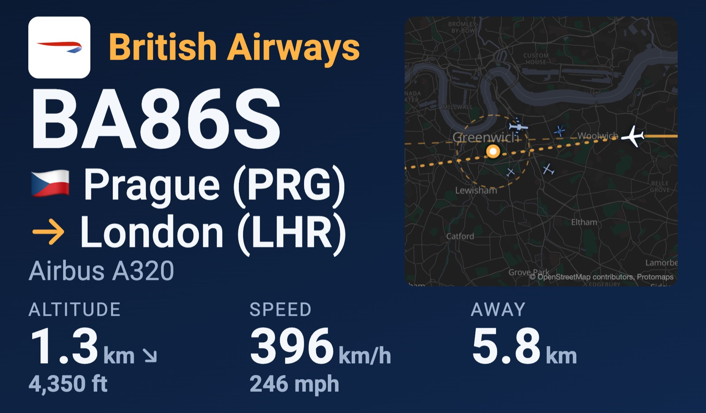
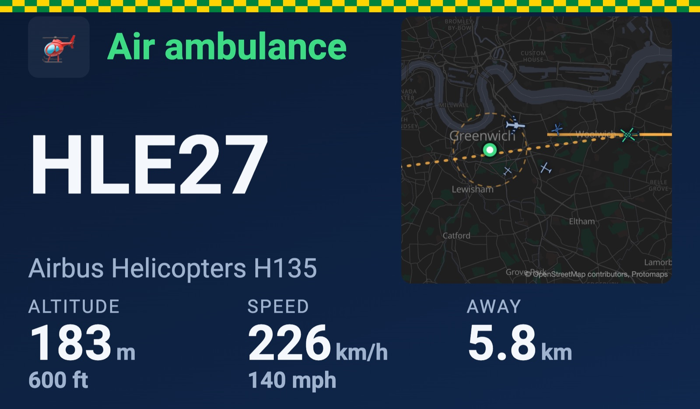
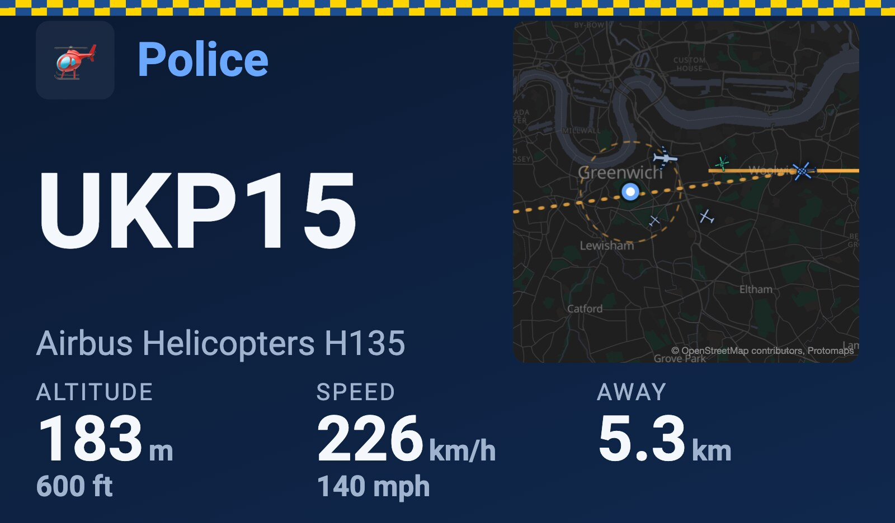
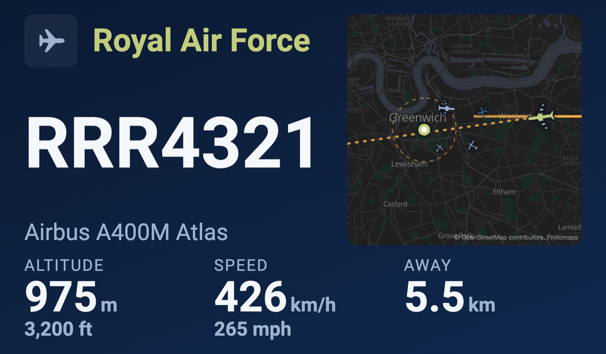
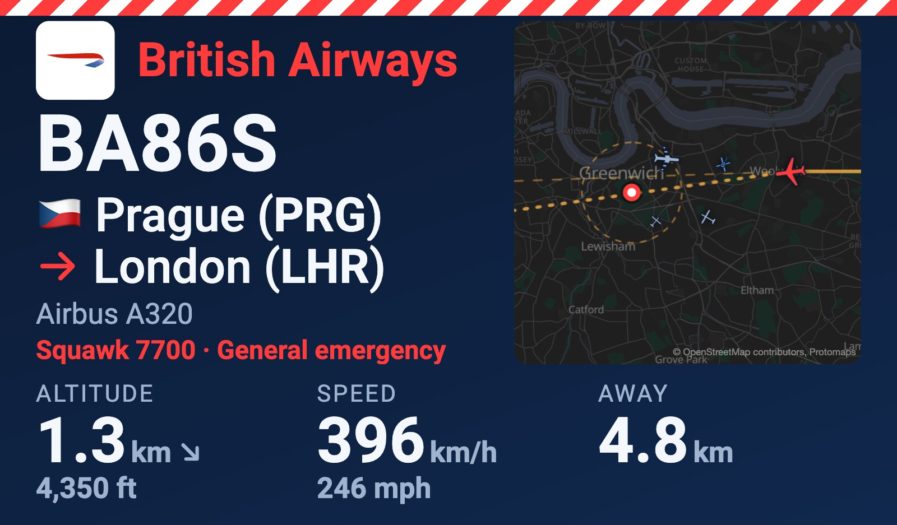
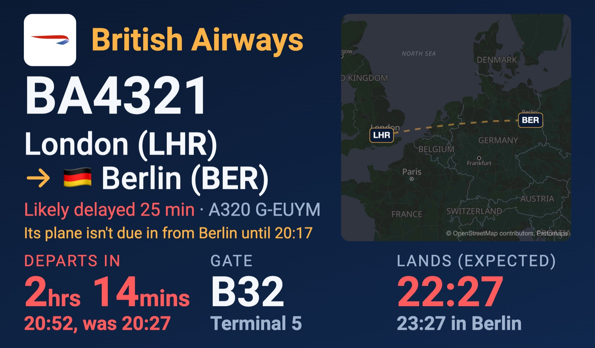
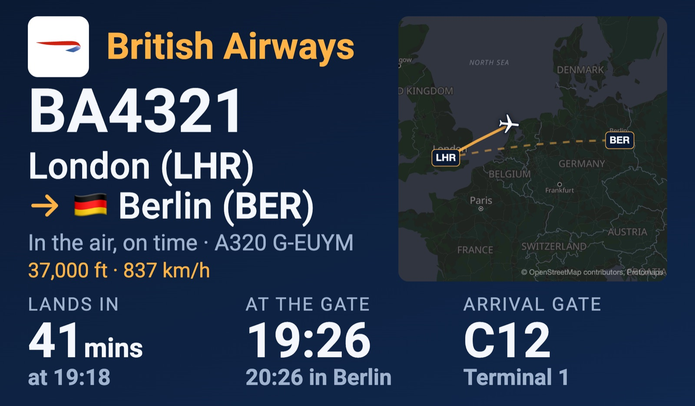
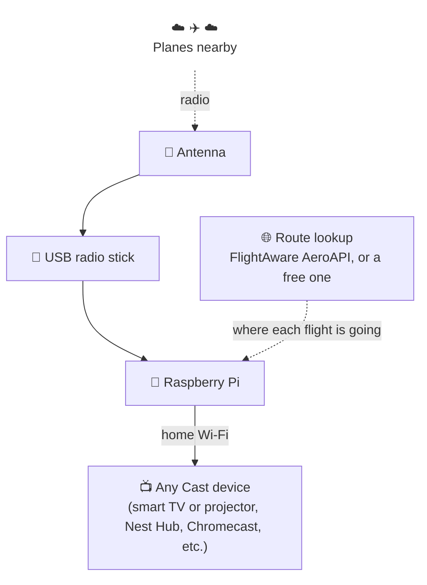
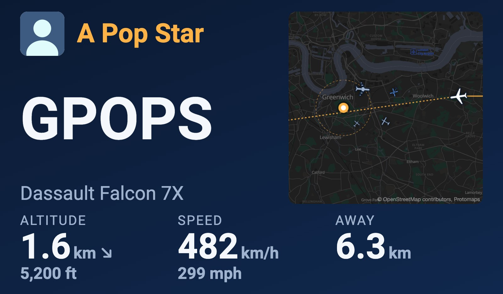

# Sky Above ✈️

Hear a plane, look up, wonder where it's going? Sky Above tells you. When a plane flies near home,
your TV or smart display shows who it is and where it's headed, and reads it out loud. 🛬



| | |
|---|---|
|  |  |
| 🚁 Air ambulances get their own look... | 👮 ...and so do the police |
|  |  |
| 🪖 Military aircraft go olive | 🚨 A plane in an emergency goes red and takes over the screen |
|  |  |
| 🧳 A flight you're following, before it leaves... | ...and on its way |

*All made-up flights, with Greenwich standing in for home.*

## What you get

- 📺 A big, easy to read card: airline, flight, from, to, height, speed
- 🗣️ A voice that announces each plane ("from Alicante, to London Stansted, 1 kilometre away")
- ⏱️ A heads-up for planes on their way ("overhead in about 4 minutes"), timed for when you actually hear it, or "overhead now" if it'll be right above you by then
- 🧳 Flights you care about, yours or friends' and family's, followed from four hours before take-off until landing
- 🚁 Air ambulance and police helicopters in their own colours, where your country gives them their own callsigns or squawks
- 🪖 Military aircraft in olive, named by who flies them ("Royal Air Force, Airbus A400M Atlas")
- 🌟 Famous aircraft say who they belong to: a pop star's jet, a football club's 737, the King's helicopter
- 🚨 Planes in an emergency, anywhere your antenna can hear them: squawking 7700, 7600 or 7500, or
  diving or climbing far faster than any normal flight for most of a minute. They go red, take the screen until it's
  over, and get read out a bit louder
- 🗺️ A live map of every plane nearby
- 📜 A history page of everything it's shown, to filter by airline, military, police, air ambulance, private and famous
- 🏠 Your location never leaves the house

## How it works



1. Every airliner broadcasts where it is, several times a second.
2. The antenna and stick pick that up.
3. The Pi finds the closest plane and looks up where it's going.
4. It sends a card to your screen, like casting a video from your phone.

## What you need 🛒

| Thing | Roughly |
|---|---|
| Raspberry Pi 4 (or any newer Pi) and a microSD card, 32 GB or larger | £60 |
| FlightAware Pro Stick Plus (the USB radio) | £60 |
| A 1090 MHz antenna | £8 |
| Any Cast device on your Wi-Fi (smart TV or projector, Nest Hub, Chromecast, etc.) | you probably have one already |
| A Google Cast developer account, a one-off fee | $5 |
| A FlightAware AeroAPI key, for routes (optional but worth it) | free |

You'll also need a computer to set up the Pi from. You'll copy and paste a few commands, but you
don't need to know what they mean.

## Setting up 🍓

Set aside an hour. Most of it is waiting.

### Step 1: Get the Pi going

1. Install **Raspberry Pi Imager** on your computer. On a Mac with [Homebrew](https://brew.sh):

   ```bash
   brew install --cask raspberry-pi-imager
   ```

   No Homebrew? Either install it first (the one line on [brew.sh](https://brew.sh)), or download
   Imager straight from [raspberrypi.com/software](https://www.raspberrypi.com/software/), which
   also has it for Windows and Linux.
2. Put the microSD card in your computer, open Imager, and choose:
   - **Device:** your Pi
   - **Operating system:** Raspberry Pi OS (other), then **Raspberry Pi OS Lite (64-bit)**
   - **Storage:** the card
3. When it asks about customising, fill in:
   - a name for the Pi (say `skyabove`)
   - a username and password
   - your Wi-Fi
   - turn on SSH
4. Put the card in the Pi, plug the stick into a **black** USB port, attach the antenna, power it up.
5. On your computer, open Terminal and connect to the Pi (use your username):

   ```bash
   ssh you@skyabove.local
   ```

6. Update everything on the Pi:

   ```bash
   sudo apt update && sudo apt full-upgrade -y
   ```

7. Stop the Pi grabbing the stick. Inside, the stick uses the same chip as a USB TV tuner (with a
   filter and amplifier for planes added), so the Pi thinks it's for watching TV and won't let
   anything else have it. This writes a small file telling it to leave the stick alone, so Sky Above
   can use it as a radio instead. FlightAware's own PiAware image does this for you, plain Raspberry
   Pi OS doesn't:

   ```bash
   printf "blacklist dvb_usb_rtl28xxu\nblacklist rtl2832_sdr\nblacklist rtl2832\nblacklist rtl2830\nblacklist dvb_usb_v2\n" | sudo tee /etc/modprobe.d/blacklist-rtl-sdr.conf
   ```

8. Install Docker, which runs all the parts of Sky Above, and restart:

   ```bash
   sudo apt install -y docker.io docker-compose git && sudo usermod -aG docker "$USER" && sudo reboot
   ```

### Step 2: Install Sky Above

1. Connect again once it's restarted (`ssh you@skyabove.local`), then:

   ```bash
   git clone https://github.com/christianjbrown/sky-above.git ~/sky-above && cd ~/sky-above && cp .env.example .env
   ```

2. Open the settings file:

   ```bash
   nano .env
   ```

3. Fill in:
   - `FEEDER_LAT` and `FEEDER_LONG`: where the antenna is (right-click your house in Google Maps to
     copy them)
   - `FEEDER_ALT`: how high the antenna is above sea level, in metres or feet: `30m` or `100ft`.
     Search the web for your address's elevation, then add how far up the antenna is. Close enough
     is fine.
   - `FEEDER_TZ`: your time zone, like `Europe/London`, `America/New_York` or `Australia/Sydney`
   - `HOME_COUNTRY`: your country's two-letter code, like `GB`, `US` or `DE`, so places at home get
     no flag
   - `CAST_DEVICE_NAME`: your screen's name, exactly as the Google Home app shows it
4. Save with Ctrl+O, Enter, then Ctrl+X. Start it:

   ```bash
   docker compose up -d
   ```

5. On your computer, open `http://skyabove.local:8080`. Planes should start appearing. 🎉

### Step 3: Connect your screen

Google needs to know about your screen before the Pi can show anything on it.

1. Sign in at https://cast.google.com/publish and pay the $5.
2. Click **Add new application**, then **Custom Receiver**.
   - Name: Sky Above
   - Receiver URL: `http://` then your Pi's address, then `:8090/` (for example
     `http://192.168.1.50:8090/`). Your router's app lists the address.
   - Don't publish it. Copy the **Application ID**.
3. Click **Add new device** and enter your screen's serial number (Google Home app, the screen's
   settings, Device information).
4. In the Google Home app, in the screen's settings, turn on **Send device usage data and crash
   reports**.
5. Wait about 15 minutes, then restart the screen.
6. Back on the Pi, `nano .env`, put the ID after `CAST_APP_ID=`, save, and run
   `docker compose up -d`.
7. In your router's app, give the Pi a fixed address, so it never changes.

Now wait for a plane. ✨

### Step 4: Better routes (optional)

Without a key, routes come from a free service that's often out of date.

1. Get a personal key at https://www.flightaware.com/aeroapi/portal/
2. Put it after `AEROAPI_KEY=` in `.env`, save, and run `docker compose up -d`.

FlightAware gives you $5 of lookups a month for free, or $10 if you feed them. Sky Above spends at
most $3 a month on planes overhead and $2 on followed flights, so out of the box it never costs a
penny. Feeding FlightAware? Raise `AEROAPI_MONTHLY_DOLLARS` and `FOLLOWED_MONTHLY_DOLLARS` to
make use of the extra $5. 💸 It counts each lookup at FlightAware's price, and if they ever
change their prices, `AEROAPI_PRICES` is where to put the new ones.

## Following a flight 🧳

Picking someone up, or off on holiday yourself?

1. On the Pi, `mkdir -p ~/sky-above/followed && nano ~/sky-above/followed/flights.txt`
2. Add a line with the date it leaves and the flight number. The date is the one on the ticket:
   the local date where it leaves from, whatever time zone you're in.

   ```text
   2027-03-12 BA4321
   ```

3. Save. That's it, no restart needed.

On the day, when no plane is overhead, the screen shows:

- **Before take-off:** a countdown, the gate, and any delay, in red
- **In the air:** time to landing and the plane moving on a world map
- **After landing:** the baggage belt 🛄

Airlines often say "on time" until the last minute. Sky Above also checks where the plane is coming
from, and if it can't make it back in time it says "Likely delayed 25 min" and why. 🕵️

It also speaks up when something changes 🔔:

- a gate is given out, or changes
- the delay moves by 10 minutes or more, or it's back on time
- it's cancelled or diverted
- it takes off, with when it should land
- it's about 20 minutes from landing
- it lands
- the baggage belt is given out, or changes

Each followed flight costs roughly 50 cents to $2 in AeroAPI lookups.

## Famous aircraft 🌟

Sometimes the plane overhead belongs to somebody you've heard of. When it does, the card says who,
with their picture where the airline logo usually goes, and the voice adds "belonging to ..." after
the plane.



*A made-up jet and owner. Real ones get a real photo.*

It works out of the box, nothing to set up. The Pi downloads
[plane-alert-db](https://github.com/sdr-enthusiasts/plane-alert-db), a community list of about
17,000 interesting aircraft, once a day, and looks planes up in its own copy, so nobody hears which
planes you're asking about. By default it names the owners of four of the list's categories:
celebrities ("Don't you know who I am?"), oligarchs, football clubs and royal aircraft. Want more?
Add categories such as `Head of State` or `As Seen on TV` to `NOTABLE_CATEGORIES` in `.env`.

Pictures come from Wikipedia: the lead picture of the owner's article, which is their official
portrait where they have one. Only freely licensed pictures from Wikimedia Commons are used, and
Wikipedia is only asked when one of these planes actually gets a card. The Pi then finds the face
in the photo and cuts a square round it, head and shoulders, so the picture fills the tile
instead of sitting in a strip down the middle of it. 🔍 A photo with no face it can find is cut
from the top, where a head usually is.

### Fixing names 📝

Plenty of celebrity jets are registered to a company standing in for the person, so the list says
"Island Jet Inc" where you'd want a name. Fix that with `notable/names.txt` next to
`docker-compose.yml` on the Pi, one plane to a line: the registration, then who it belongs to.

```
# Lines starting with # are ignored.
G-ABCD A Football Club
G-EFGH A Pop Star
G-IJKL The King | Charles III
G-MNOP Drake | Drake (musician)
```

- A line here beats the list, and can add a plane the list doesn't have at all.
- After a `|` goes the owner's Wikipedia article, for when it isn't simply the name on the card,
  or when the name could be several people (Drake, say). That's where the picture comes from.
- Changes get picked up within the hour, no restart needed.
- It's gitignored, so your list never ends up on GitHub.

### Your own pictures 🖼️

Football clubs, teams and companies only have logos and crests on Wikipedia, and those are there
under fair use, so Sky Above won't fetch them. You can still use them at home: drop a picture into
`own-portraits/` next to `docker-compose.yml` on the Pi, named after the owner in lower case with
hyphens for spaces and punctuation, like `a-football-club.png`. Where you've given a Wikipedia
article after a `|`, name it after that instead (`charles-iii.jpg`). JPG, PNG, WebP and SVG all work.
A picture here wins over Wikipedia's and sits whole on white, like an airline logo. The next card
picks it up, and it's gitignored too, like `own-logos/`.

## What flew over 📜

Every plane that gets the card goes into a history on the Pi: when it showed up, the flight, where
it was going, the aircraft, how close and how low it came, and, for famous owners' planes, who
they belong to and what plane-alert-db lists them as. Open `http://skyabove.local:8090/history` on
your desktop to see it. ✈️

Filter it however you like, ticking as many as you want: airlines, military, police, air
ambulances, private helicopters and private planes, a chip for each airline it has seen, and
🌟 **Famous only** for "did anyone interesting fly over?". There's a search box too, for a flight,
an owner, an aircraft or a place.

It never leaves the Pi. Airline flights are the bulk of it, so they're forgotten after 90 days
(`airlines_kept_days` in the tunings). Everything rarer, famous planes included, stays for good,
and at a few hundred bytes a plane that's nothing for the SD card. The same data is at
`/live/history.json` if you'd like to do something of your own with it.

## Good to know

- 🤫 **Quiet hours.** Nothing on the screen from midnight to 8am, except helicopters and military
  aircraft, which are rare enough to be worth waking up for. Don't want those either? Set
  `QUIET_HOURS_EXCEPT=` (empty) in `.env`.
- 🚨 **Emergencies win.** A plane in an emergency beats everything, quiet hours included, and stays
  up until it has been over for a minute. Air ambulances, police and military aircraft, and
  famous people's planes, get a card and a voice wherever the antenna hears them, after whatever
  is overhead. One that comes into the zone keeps the card until it's 5 km away, so a plane
  passing through waits its turn.
- 🔇 **Only what you'll hear gets a voice.** A flight overhead is announced when its destination is
  known and it passes lower than 5 km, so you can hear it (`heard_below_km` in the tunings).
  Anything higher, or with no destination, is shown without a word.
  On a Nest Hub the emergency announcement turns the volume up to 8 out of 10 (never down) and puts
  it back afterwards.
- 🔔 **It tells you when it's stuck.** A little watchdog checks on the watcher every minute and
  shouts if it stops looking at the sky, keeps failing (say the screen has gone), or the antenna
  hears nothing for an hour, then again once it's fine. Put an [ntfy](https://ntfy.sh) topic like
  `https://ntfy.sh/<a-long-random-name>` after `ALERT_URL=` in `.env` and subscribe to it in the
  ntfy app to get those on your phone. Without one they just land in `docker compose logs watchdog`.
- 🔄 **It can update itself.** Run `tools/install-auto-deploy.sh` once on the Pi and it checks
  GitHub every five minutes. New versions get built in the background, but only swapped in when
  the card is clear, so nobody gets cut off mid-sentence. Quiet hours make sure there's a gap every
  night.
- 🛬 **Planes come first.** When there's one to show, it takes the screen from whatever is on it,
  music and films included, and hands it back once the sky is clear. Anything else casting to the
  same screen just has to wait its turn.
- 🧪 **Try it without a plane.** Open `http://skyabove.local:8090/?demo` for a made-up one. Also
  `?demo=followed`, `?demo=taxiing`, `?demo=flying`, `?demo=landed`, `?demo=ambulance`, `?demo=police`, `?demo=military`, `?demo=emergency` and `?demo=notable`.
- 🏠 **Privacy.** Your location stays in `.env` on the Pi. The Pi does ask FlightAware about planes
  passing near you, which hints at roughly where you are. Leave `AEROAPI_KEY` empty and set
  `ROUTE_API_URL=` to stop that.

## Handy commands 🧰

Run these on the Pi, from `~/sky-above`:

| To | Run |
|---|---|
| See what's running | `docker compose ps` |
| Watch what it's doing | `docker compose logs -f watcher` |
| Update Sky Above | `git pull && docker compose up -d --build` |
| Have it update itself | `tools/install-auto-deploy.sh` (once) |
| See what it updated | `journalctl -t sky-above-deploy` |
| See what flew over | open `http://skyabove.local:8090/history` |
| Update everything else | `docker compose pull && docker compose up -d` |
| Check the power supply | `vcgencmd get_throttled` (0x0 is good) |

## Settings ⚙️

All in `.env`. After changing one, run `docker compose up -d` so it takes effect. The ones you're
most likely to change:

| Setting | What it does | What to put | Default |
|---|---|---|---|
| `ZONE_RADIUS_KM` | How close a plane has to be | kilometres, like `1.5` | `2` |
| `QUIET_HOURS` | When it won't cast at all | start and end, like `00:00-08:00`, optionally on certain days (`Sat 00:00-10:00`, `Mon-Fri 09:00-17:00`), several comma separated, or empty for never | `00:00-08:00` |
| `SPEECH_QUIET_HOURS` | When it won't speak | the same as above | `00:00-08:00` |
| `QUIET_HOURS_EXCEPT` | What still gets through both kinds of quiet hours | `helicopters`, `military`, both, or empty for nothing | `helicopters,military` |
| `SPEECH_SERVER` | Where the voice comes from | empty for no voice at all | the Pi's own |
| `PIPER_VOICE` | Which voice it speaks in | any voice name from the list below | `en_GB-southern_english_female-low` |
| `AEROAPI_MONTHLY_DOLLARS` | Most it spends on AeroAPI route lookups a month | dollars, like `3` | `3` |
| `FOLLOWED_MONTHLY_DOLLARS` | Most it spends on followed-flight lookups a month | dollars, like `2` | `2` |
| `AEROAPI_PRICES` | What FlightAware charges per request, to count the dollars above | `path=dollars` pairs, comma separated, `*` for any one part of the path | `flights/*/position=0.010,flights/*=0.005,operators/*=0.015` |
| `AEROAPI_UNLISTED_PRICE` | What a request to any other path is counted as | dollars | `0.200` |
| `LINGER_SECONDS` | How long the card stays after the plane leaves | seconds | `30` |
| `CARD_MIN_SECONDS` | The shortest time a plane's card is up | seconds | `60` |
| `AIR_AMBULANCE_CALLSIGNS` | Which planes get the air ambulance look | the code their callsigns start with, like `HLE` in the UK | empty |
| `POLICE_CALLSIGNS` | Which planes get the police look | the same, like `UKP` in the UK | empty |
| `AIR_AMBULANCE_SQUAWKS` | More planes that get the air ambulance look | the squawks set aside for them, ranges allowed | empty |
| `POLICE_SQUAWKS` | More planes that get the police look | the same, like `0032,0041-0061` in the UK | empty |
| `NOTABLE_CATEGORIES` | Which of plane-alert-db's categories say who they belong to | category names, comma separated, like `Head of State` or `As Seen on TV` | `Don't you know who I am?,Oligarch,Football,Royal Aircraft` |
| `PORTRAIT_API_URL` | Where owners' pictures come from | Wikipedia's REST API address, or empty for no pictures | English Wikipedia |
| `NOTABLE_AIRCRAFT_URL` | Where the list of notable aircraft comes from | an address, or empty for none | plane-alert-db on GitHub |
| `ALERT_URL` | Where the watchdog sends alerts | an ntfy topic address, or empty to only log them | empty |

🗣️ **Picking a voice.** Have a listen on [Piper's samples page](https://rhasspy.github.io/piper-samples/),
pick one, and use its name, which is the language, the voice and the quality joined by hyphens. A
few to try:

- `en_GB-alan-medium`, a British man
- `en_GB-jenny_dioco-medium`, a British woman
- `en_GB-northern_english_male-medium`, a man from the north of England
- `en_US-lessac-medium`, an American woman

`low` voices sound a bit rougher but are quicker to make, `medium` ones are clearer. The Pi
downloads a new voice the first time it's used.

`.env.example` lists the rest, with a note on each.

### Fine tuning 🎛️

Everything else about how it behaves lives in `tuning/tuning.toml`: how long answers are kept, how
sure it has to be that a plane is on its way, how often a followed flight is checked, which
airports are said by city, how a word like MAX is pronounced, and so on. Each value has a note
saying what it does.

Don't edit that file, though, because the Pi updates itself from git and your changes would get in
the way. Put just what you want changed in `tuning/local.toml` instead, under the same headings:

```toml
[map]
max_other_planes = 20

[airports.cities]
Madrid = ["MAD"]
```

Then run `docker compose up -d watcher`. A list replaces the whole list, and a misspelt name stops
the watcher with a message saying which one, so nothing gets quietly ignored. 🧐

## For the curious 🔍

<details>
<summary>Sharing with FlightAware and Flightradar24 (free premium accounts)</summary>

Optional and separate from Sky Above. Two extra containers pass on what your stick hears, and in
return you get a free FlightAware Enterprise account and Flightradar24's Contributor plan.

**FlightAware.** Get a feeder ID:

```bash
timeout 60 docker run --rm ghcr.io/sdr-enthusiasts/docker-piaware:latest | grep "my feeder ID"
```

Put it in `.env` as `PIAWARE_FEEDER_ID`, add `flightaware` to `COMPOSE_PROFILES`, run
`docker compose up -d`, then claim the receiver at https://flightaware.com/adsb/piaware/claim.

**Flightradar24.** Get a sharing key:

```bash
docker run -it --rm --entrypoint /usr/bin/fr24feed ghcr.io/sdr-enthusiasts/docker-flightradar24:latest --signup --configfile=/tmp/config.txt
```

Say no to MLAT and pick receiver type 4. Put the key in `.env` as `FR24KEY`, add `flightradar24` to
`COMPOSE_PROFILES` (`flightaware,flightradar24` for both) and run `docker compose up -d`.

Both need your exact position for MLAT. Both let you hide it from your public stats page.

</details>

<details>
<summary>What's running on the Pi</summary>

| Service | What it does |
|---|---|
| `ultrafeeder` | Decodes the radio, draws the map at `:8080` |
| `watcher` | Picks the plane and casts the card (the Python in this repo) |
| `watchdog` | Checks the watcher every minute and sends alerts (the same Python) |
| `receiver` | Serves the card page at `:8090` |
| `piper` | Turns announcements into speech, on the Pi |
| `piaware`, `flightradar24` | The optional feeders |

</details>

<details>
<summary>How it picks a plane</summary>

- A plane inside the zone always gets a card.
- A plane further out has to hold a steady course pointing through the zone, for five seconds plus
  two for every km away. That rules out anything beyond about 38 km.
- Planes coming down low more than 10 km out (air traffic control is steering them in to land, so
  their line means nothing) and planes that will land before they reach you don't count. Planes
  climbing out after take-off do, even though their departure route sometimes turns them away
  at the last moment, because they're low and heard late.
- Planes that come overhead teach it the paths they flew to get there. Once two of them have
  come along the same path, the next plane at the same spot, height and heading gets its card
  straight away, even mid-turn onto a departure route, where its straight line points somewhere
  else for a while. Each runway's route is learned separately, and the paths are kept in
  `paths.json` in the watcher's state, so a restart doesn't forget them.
- It learns the misses too. A plane whose line pointed through the zone but then turned away
  leaves a note of where it was and which way it was going (the direction of its destination).
  Once two planes heading the same way have missed from the same spot, and none heading that way
  has come overhead from there, a straight line from that spot stops counting. Planes off one
  runway share the climb out and split by destination, so a flight that turns north and one that
  comes your way are told apart. Those notes live in `missed.json`. With an AeroAPI key, the
  direction comes only from routes already looked up for a card, so a plane that never comes
  near costs nothing; a flight that passes daily is known from its second day.
- The card stays 30 seconds after the plane leaves (`LINGER_SECONDS`), and at least a minute in all
  (`CARD_MIN_SECONDS`).
- Places in your own country (`HOME_COUNTRY`) have no flag. Leave it empty and it goes by the
  airport nearest home, which is fine unless you live near a border.
- A plane on its way waits for the card on screen to finish its time before it's shown and
  announced. A plane that comes into the zone takes over straight away.

</details>

<details>
<summary>How it guesses delays</summary>

It follows the plane's earlier flights that day. Each one gets its typical gate-to-gate time over
the last week, then a turnaround of 25, 35 or 75 minutes depending on the plane's size. If that
lands later than the airline's time, the card goes with ours.

</details>

<details>
<summary>Maps</summary>

The maps come from [Protomaps](https://protomaps.com) and live on the Pi, so the screen never asks
a map server anything. They're too big for git, so cut them into `map/` with the
[pmtiles](https://github.com/protomaps/go-pmtiles) tool, using a build date from
https://maps.protomaps.com/builds:

```bash
pmtiles extract https://build.protomaps.com/20261101.pmtiles map/area.pmtiles --bbox=-0.85,51.15,0.85,51.8 --maxzoom=14
pmtiles extract https://build.protomaps.com/20261101.pmtiles map/world.pmtiles --maxzoom=6
```

The `--bbox` is the area round home, as west, south, east, north. That one is about 60 km each way
round Greenwich: take your own longitude and latitude and go about 0.85 either side of the
longitude and 0.33 either side of the latitude. No maps? The card just goes without.

Place names not in the Latin alphabet need their fonts too: see `tools/fetch_map_assets.py`.

</details>

<details>
<summary>Airports, flags and logos</summary>

- Airports come from [OurAirports](https://ourairports.com/data/) (public domain). Refresh with
  `python3 tools/fetch_airports.py`.
- Logos come from [Soaring Symbols](https://github.com/anhthang/soaring-symbols) (MIT), plus a few
  public-domain and CC0 ones from Wikimedia. Refresh with `python3 tools/fetch_airline_logos.py`.
- Missing an airline? Drop its logo into `own-logos/` on the Pi as `<ICAO code>.svg` (say `CSZ.svg`
  for Shenzhen Airlines) and the card picks it up on the next plane, no restart needed. 🎨 It wins
  over the repo's own logo, and it's gitignored, so logos you can use at home but can't hand out
  never end up on GitHub.
- Notable aircraft come from [plane-alert-db](https://github.com/sdr-enthusiasts/plane-alert-db)
  (Open Database License), which the Pi downloads once a day rather than the repo keeping a copy.
  Owners change, so now and then it'll name somebody who has sold up.
- Owners' pictures come from [Wikimedia Commons](https://commons.wikimedia.org) through
  Wikipedia, freely licensed by their photographers, who are credited on each picture's page
  there. Logos and crests uploaded to Wikipedia under fair use are skipped.
- Faces are found with [YuNet](https://github.com/opencv/opencv_zoo/tree/main/models/face_detection_yunet)
  (MIT), the face detector in OpenCV's model zoo, which the watcher ships a copy of.
- The map's scripts and fonts are fetched by `python3 tools/fetch_map_assets.py`.
- The map runs on [MapLibre GL JS](https://maplibre.org) and [PMTiles](https://github.com/protomaps/PMTiles)
  (both BSD-3-Clause), styled with [Protomaps basemaps](https://github.com/protomaps/basemaps), in
  Noto Sans (SIL Open Font License). Map data is © [OpenStreetMap](https://www.openstreetmap.org/copyright)
  contributors.
- Airline names and logos belong to their airlines, and are here only to show which plane is which.

</details>

<details>
<summary>https</summary>

The card can be served over https with a Let's Encrypt certificate. Point a domain you own at the
Pi's home address, set `CERT_DOMAIN`, `SPACESHIP_API_KEY` and `SPACESHIP_API_SECRET` in `.env`, and
run `docker compose up -d`. Then restart the receiver and change the Cast app's URL to
`https://<your domain>/`.

Got another app on the same Pi that wants https too? Only one thing can have port 443, so
Sky Above serves it for them: point that app's own name at the Pi as well, add it to `OTHER_SITES` as
`name=port` (for example `tube.example.com=8095`), and run `docker compose up -d`. Each name gets
its own certificate, and the receiver passes it through to that port once the certificate is there.

Over https, a link to the page shares with a preview card 🖼️ (`receiver/og.jpg`, drawn from
`docs/og-card.html`). Previews need the image's full address, which nginx fills in from
`CERT_DOMAIN`.

</details>

<details>
<summary>Making a change</summary>

You need Docker, [uv](https://docs.astral.sh/uv/) and Node. One command runs every check:

```bash
tools/check.sh
```

That's the watcher formatted, linted and strictly typed, and both the watcher and the card's
browser code at 100% test coverage, lines and branches. 💯 CI runs the same script on every pull
request, and if you point git at the hooks (`git config core.hooksPath .githooks`) it runs before
every push too.

</details>

Best enjoyed when a helicopter goes over. 🚁

MIT licensed, see [LICENSE](LICENSE).
